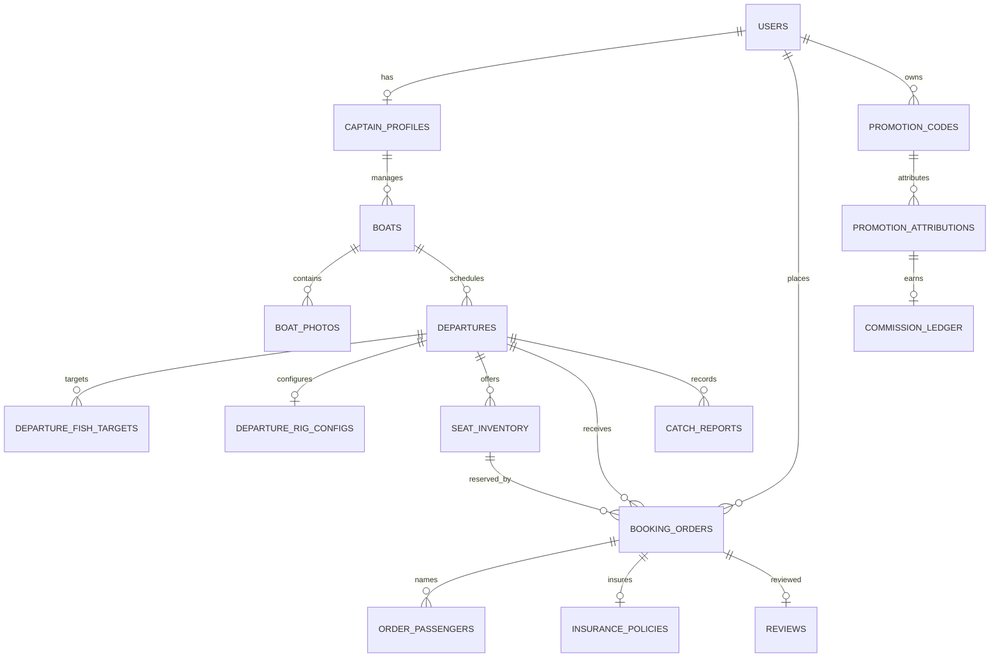

# 核心数据模型 v1

首版关系型模型，迁移位于 `server/migrations/001_core_schema.sql`。数据库采用 PostgreSQL；Redis 用于后续缓存、短期锁与限流，不作为订单或佣金的唯一数据源。

## 约定

- 主键使用 UUID；创建/更新时间使用带时区的 `timestamptz`。
- 所有金额以人民币整数分存储，字段名以 `_fen` 结尾；重量使用克，船长使用厘米。
- 班次的成行保底按 `minimum_sailing_total_fen`（最低成行总价）记录，不以人数作为合同保底口径。
- 平台订单金额只由船位费减优惠再加平台服务费构成；保险由承保公司外部收取，保险费不进入平台订单或收银台。
- 鱼种以《青岛鱼种库 v1》的标准 `fish_code` 引用，活动主攻鱼种单班 1–3 种的规则由服务层校验。
- 手机号、姓名、身份证号及船舶登记信息仅保存应用层加密密文；手机号 HMAC 摘要用于查重/检索。加密密钥由部署环境的密钥服务管理，禁止写入仓库或数据库迁移。
- 船照片、证件扫描件、鱼获照片使用对象存储 URI，数据库不存放图片二进制。
- 取消/退款、保险出单与佣金解冻由后续步骤的事务和状态机实现；状态字段不代表已接入真实支付或保险商户。

## 实体与字段

| 实体 | 关键字段 | 说明 |
| --- | --- | --- |
| `users` 用户 | `id`、`phone_ciphertext`、`phone_hash`、`display_name`、`legal_name_ciphertext`、`identity_number_ciphertext`、`identity_verified_at`、`status` | 同一账号可作为钓友、推广员或船长；手机号摘要唯一。 |
| `captain_profiles` 船长 | `user_id`、`captain_name`、`license_reference`、`verification_status`、`verified_at` | 与用户一对一；资质原件由审核材料存储管理。 |
| `boats` 船档案 | `id`、`captain_user_id`、`name`、`length_cm`、登记资料密文/URI、`home_marina_code`、`facilities`、`seat_template_code`、`seat_count`、`comfort_level`、`review_status` | 长期船档案，平台按船长与实测间距计算舒适度并生成钓位模板。 |
| `boat_photos` 船图 | `boat_id`、`photo_kind`、`object_uri`、`sort_order` | 船外观、甲板、船舱、厕所和证件图片索引。 |
| `departures` 班次 | `boat_id`、`captain_user_id`、`trip_type`、出返港时间、`target_area_code`、`marina_code`、`minimum_sailing_total_fen`、各项价格、`booking_deadline`、`status` | 每次发班的可检索活动主记录；成行保底是总价，不是人数。`experience` 为体验班，`pro_fishing` 为专业拼船。 |
| `departure_fish_targets` 目标鱼种 | `departure_id`、`fish_code`、`sort_order` | 班次与标准鱼种多对多关联。 |
| `departure_rig_configs` 钓组 | 饵料、供给方式、主线 PE、前导线、铅坠形状和克数区间 | 与班次一对一；体验班由服务层转换为包含清单话术。 |
| `seat_inventory` 钓位库存 | `departure_id`、`seat_number`、`price_fen`、`status`、`hold_expires_at` | 每班按船型模板生成；并发锁位应在事务中锁定库存行，十分钟超时后释放。 |
| `booking_orders` 订单 | `order_number`、`departure_id`、`seat_inventory_id`、`buyer_user_id`、`status`、`seat_fee_fen`、`discount_fen`、`platform_fee_fen`、`total_amount_fen`、锁位/付款/取消时间 | 平台应付 = 船位费 − 优惠 + 平台服务费；保险费不在平台订单中。当前阶段不含真实支付实现。活动+座位+用户关系在服务层校验。 |
| `order_passengers` 乘船人 | `order_id`、姓名/身份证/手机号密文、`identity_verified_at` | 每位实名乘船人一条；服务层校验人数与钓位数一致。 |
| `insurance_policies` 保险状态 | `order_id`、`provider_code`、保单引用、保额、`status`、`checkout_url`、`issued_at` | 每单一个关联状态，可记录外部投保跳转和回查结果。 |
| `reviews` 评价 | `order_id`、`reviewer_user_id`、`boat_id`、`rating`、`tags`、`body` | 数据库限制每订单一条；仅已完成订单可评价由服务层校验。 |
| `catch_reports` 渔获回填 | `departure_id`、`author_user_id`、`source`、`fish_code`、数量、克重、照片 URI、报告时间 | 支持船长与乘客两类来源，供后续交叉核验与图鉴使用。 |
| `promotion_codes` 推广码 | `owner_user_id`、`code`、`channel`、`status` | 会员、酒店/旅行社、达人、船长、码头等一级推广来源。 |
| `promotion_attributions` 推广归因 | `promotion_code_id`、`attributed_user_id`、`order_id`、匿名归因摘要、时间 | 一笔订单最多一条归因；不支持多级分销。 |
| `commission_ledger` 佣金账本 | `promotion_attribution_id`、`payee_user_id`、`amount_fen`、`status`、解冻/支付/回滚时间 | 佣金的唯一账务事实源；冻结、可提现、已支付、回滚均留账。 |

## 关系图

## 需要事务保证的写入

1. 锁位：对 `seat_inventory` 目标行执行行级锁，确认班次可报名、钓位可用，再创建十分钟待支付订单并一起写入锁位状态。
2. 支付回调：校验幂等键与订单金额后更新订单/钓位状态；保险外部出单状态独立记录。
3. 取消/退款：根据活动状态和退改规则计算退款，订单与座位库存原子更新，重复回调不重复退款。
4. 佣金：仅关联真实成交订单；行程完成后加冻结账，完成约定冻结期后转可提现，退款按原订单反向记账。

以上是第 0 步数据结构，不代表支付、保险、实名服务或结算已经接入真实供应商。
